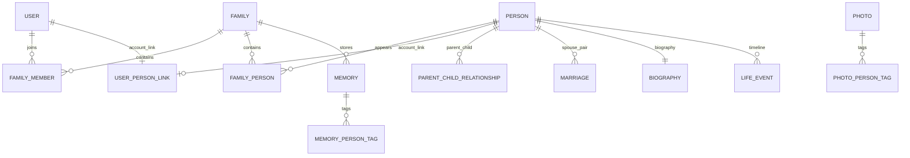
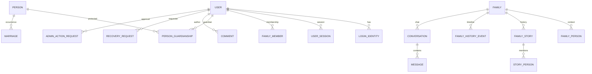

# Гуулингийнхан — Phase 4.1 архитектур ба суурийн шалгалт

**Repo:** `AriukagiinTuvshoo/guulingiinhan`  
**PR:** #1, `feature/backend-foundation`  
**Зорилтот head:** `519af364f78e4ab6d3354958a2e799bd05672fc9`  
**Огноо:** 2026-09-24  
**Хязгаар:** P4.1 — migration graph ба өгөгдлийн сангийн суурь. Хэрэглэгчийн хүссэн ирээдүйн архитектурын тайлан; guardian, identity provider, admin, chat зэрэг дараагийн үеийн боломжийг энэ P4.1 commit-д хэрэгжүүлээгүй.

> Workspace-д `.git` байхгүй. GitHub PR metadata-аар branch/head-ийг тогтоож, файлын audit-ийг workspace дахь кодын snapshot дээр хийв. PR head-ийн GitHub Actions PostgreSQL workflow-г тусад нь шалгав.

## A. Одоогийн архитектур

| Давхарга | Бодит байдал |
|---|---|
| Frontend | Next.js App Router + TypeScript; `/login`, `/register`, `/families`, `/tree`, `/profile`, `/memories`, `/invite`, `/onboarding`. Зарим шинэ route API хэрэглэдэг; үндсэн нүүр/demo tree хуучин жишээ өгөгдөлтэй хэвээр. `lib/api.ts` cookie-той хүсэлт илгээнэ. |
| Backend | FastAPI, SQLAlchemy, Pydantic; `/api/v1/auth`, `/api/v1/families`, `/api/v1/invitations`. Харилцааны cycle шалгалт `relationships.py`-д. |
| Database | PostgreSQL production target; SQLite development/test боломжтой; Alembic migration. 3 revision, нэг head. |
| Authentication | Email/password, scrypt hash, DB-д raw биш hash session token, HttpOnly cookie, 7 хоногийн session, login throttle. `email_verified_at` талбар байгаа ч verification flow байхгүй. |
| Authorization | Family membership бүх family endpoint-д; `owner/editor/member` role write action-уудыг ялгана. Person visibility `private/family/public`; private нь creator эсвэл linked user-д. Guardian grant байхгүй. |
| Storage | `photos.object_key` болон `families.profile_photo_key` object key ашигладаг; upload/provider/signed URL байхгүй. Person зураг `profile_photo_url` хэвээр. |
| CI/CD | GitHub Actions frontend production build, backend pytest/Ruff, PostgreSQL migration upgrade/schema check. Vercel/deploy энэ фазын хүрээнд хийгдээгүй. |

## B. Одоогийн ERD ба constraints



- `User` ба `Person` тусдаа; `UserPersonLink` дээр `user_id` болон `person_id` тус бүр unique.
- `FamilyMember(family_id,user_id)` unique; role check: `owner/editor/member`.
- `FamilyPerson(family_id,person_id)` unique; нэг хүн олон family-д байж болно.
- `ParentChildRelationship(parent_id,child_id)` unique, өөрийгөө parent болгохгүй, төрөл нь `biological/adoptive`; cycle-г service/API шалгана.
- `Marriage` canonical UUID order, өөртэйгөө marriage үүсгэхгүй, огноо шалгана. Хосын `(person_1_id,person_2_id)` unique нь A+B салсны дараа дахин A+B marriage бүртгэхийг хориглодог.
- `Biography.person_id` unique. `LifeEvent(person_id,event_date)`, `FamilyMember`, `FamilyPerson`, `ParentChildRelationship`, `Marriage`, `Memory`, `Photo`-д суурь индексүүд бий.
- `AuditLog` одоогоор actor/family/action/target/time-тэй; reason, request id, role snapshot, before/after байхгүй.

## C. Зорилтот ERD

Одоогийн entity-үүдийг хадгалж дараагийн phase-уудад additive байдлаар өргөтгөнө. Доорх нь target; P4.1-д шинэ domain хүснэгт нэмээгүй.



Зорилтот нэмэлтүүд: `login_identities`, `otp_challenges`, `identity_link_requests`, `person_guardianships`, `recovery_requests`, `family_stories`, `family_history_events`, `story_person_tags`, `comments`, `reactions`, `admin_roles/user_admin_roles`, `admin_action_requests`, `conversations`, `conversation_members`, `messages`, `message_attachments`. Эдгээрийн бүрэн талбар/permission задаргаа P4.2+ дизайн review-д баталгаажна.

## D. Migration plan ба P4.1 үр дүн

### Одоогийн гинж

| Revision | `down_revision` | Өөрчлөлт |
|---|---|---|
| `4532a98a2fe5` | `None` | User, Family, Person, relationship, biography, event, memory, photo суурь schema |
| `f10695a88229` | `4532a98a2fe5` | `user_person_links`, memory-person tag, family photo key |
| `74a31c87f462` | `f10695a88229` | User active/update fields, session, invitation, throttle, audit, family archive, marriage soft-delete |

Audit-ийн өмнөх тайланд энэ гинжийг branch гэж буруу тэмдэглэсэн байв. `alembic history --verbose` болон `alembic heads`-ээр нэг head (`74a31c87f462`) гэдгийг шалгаж, аудитын баримтыг залруулсан.

### P4.1 өөрчлөлт

| Үйлдэл | Хүснэгт/constraint | Үр дүн |
|---|---|---|
| Add | Migration graph test | `ScriptDirectory.get_heads()` яг нэг head-тэй байхыг тестлэнэ |
| Add | PostgreSQL CI | `upgrade head → downgrade -1 → upgrade head → alembic check` шалгана |
| Alter | Alembic config | `path_separator=os`, хуучин path parsing deprecation warning-ийг арилгана |
| Documentation | `DATABASE.md`, `ARCHITECTURE.md`, `DEPLOYMENT.md` | Migration chain болон downgrade-ийн өгөгдөл алдах эрсдэлийг тодорхой болгов |
| Schema migration | Байхгүй | P4.1 audit-аар одоогийн schema-д шинэ хүснэгт/constraint шаардлага илрээгүй; production data-д хүрэхгүй |

**Downgrade анхааруулга:** `74a31c87f462`-оос `f10695a88229` рүү downgrade хийхэд `user_sessions`, `invitations`, `login_throttles`, `audit_logs` хүснэгтүүд бууна. Тэндхийн өгөгдөл устах тул CI-ийн хоосон PostgreSQL ба түр SQLite шалгалтад л хэрэглэнэ. Production rollback-д downgrade ашиглахгүй; backup/restore баталгаажуулалт эсвэл forward-fix migration шаардлагатай. Энэ нь migration өөрөө upgrade хийхэд өгөгдөл устгана гэсэн үг биш; P4.1 upgrade additive бөгөөд одоо байгаа migration-уудыг өөрчлөөгүй.

## E. Permission matrix

`GUARDIAN` нь family role биш: explicit `family + person + scope` grant. Parent-child edge дангаараа access grant болохгүй. Admin role-ууд platform boundary-д үйлчилнэ.

| Үйлдэл | OWNER | EDITOR | MEMBER | GUARDIAN | USER_SUPPORT | CONTENT | SECURITY |
|---|---:|---:|---:|---:|---:|---:|---:|
| Family тохиргоо/гишүүн урилга | Тийм | Үгүй | Үгүй | Тусдаа эрх олгохгүй | Үгүй | Үгүй | Зөвхөн admin management |
| Family хүн/түүх засах | Тийм | Тийм | Өөрийн linked profile хязгаарт | Зөвхөн explicit person scope | Үгүй | Зөвхөн moderation case | Ердийн үед үгүй |
| Хүүхдийн biography/event/memory/media | Family editor дүрмээр; guardian эрх автоматаар биш | Family editor дүрмээр | Үгүй | Зөвхөн grant-д заасан `manage_*` | Үгүй | Report/moderation хүрээнд | Default hidden |
| Account recovery/contact identity | Үгүй | Үгүй | Өөрийн account хүсэлт | Хүүхдийн login identity биш | Request workflow | Үгүй | Батлах/өндөр эрсдэлийн хяналт |
| Content moderation | Family хүрээний Owner | Family хүрээний Editor | Report гаргана | Өөрийн grant хүрээнээс гадуур үгүй | Үгүй | Тийм, case/audit-тэй | Policy/audit |
| Admin role/security setting | Үгүй | Үгүй | Үгүй | Үгүй | Үгүй | Үгүй | MFA + аудит + давхар баталгаа |

## F. Privacy matrix

| Ангилал | Family member | Public search/profile | Guardian | Admin |
|---|---|---|---|---|
| `PRIVATE` | Одоогийн дүрмээр creator/linked user | Хэзээ ч үгүй | Explicit grant, зөвхөн allowed fields | Duty-specific case, log |
| `FAMILY_ONLY` | Family membership + field policy | Үгүй | Grant-ийн хүрээнд | Minimum necessary |
| `PUBLIC` adult | Одоогийн family endpoint auth хэвээр | Тусдаа public allowlist API байж болно | Хамаарахгүй | Role/action хүрээнд |
| Minor overlay | Sensitive field нь visibility-ээс давуугаар нууц | Minor үргэлж хайлтаас хасагдана | Scope/expiry шалгана | Reason, case, minimum fields |
| Contact/photo | Person output/search-д default оруулахгүй | Хэзээ ч raw phone/email/address өгөхгүй | Sensitive scope + purpose audit | Mask; өөрчлөлт approval flow |

Одоогийн `visibility` нь `private/family/public`; тусдаа `FAMILY_ONLY` enum одоогоор байхгүй. Ирээдүйн API нэршлийг existing `family` утгатай нийцүүлнэ.

## G. Identity architecture

```text
User ──< LoginIdentity(provider=email|phone|google) >── provider identifier
  ├── UserSession (opaque token hash, expiry)
  ├── OTPChallenge (hash, purpose, expiry, attempts, consumed_at)
  └── UserPersonLink ── Person
```

- `users.email/password_hash`-ийг нэн даруй арилгахгүй; identity registry нь additive backfill ба dual-read/write rollout-той байна.
- Identity unique key: email/phone-д `(provider, normalized_identifier)`; Google-д `(issuer, subject)`. Verified email нь account collision үед дангаараа merge/ownership нотолгоо болохгүй.
- Phone OTP: raw OTP DB/log-д үгүй; hash, богино TTL, нэг удаа consume, attempt cap, resend cooldown, destination/IP rate limit.
- Google OIDC: Authorization Code + PKCE, `state/nonce/iss/aud/sub` шалгалт; шаардлагагүй access/id token хадгалахгүй.
- Account recovery: хүсэлт → independent proof → support intake → эрх шалгалт/шаардлагатай бол өөр admin-ын approval → identity change → бусад session revoke → audit/notification.
- Adult account existing `Person`-той link хийхдээ identity proof болон audit шаардана. Одоогийн `link-me` endpoint нь ийм баталгаажуулалттай гэж тооцогдохгүй.

## H. Admin архитектур

- `ADMIN_USER_SUPPORT`: user lookup-ийн хамгийн бага талбар, recovery хүсэлт эхлүүлэх/батлагдсан correction, suspend/reactivate. Security configuration өөрчлөхгүй.
- `ADMIN_CONTENT`: report, family history/person/media moderation. Login identity ба recovery өөрчлөхгүй.
- `ADMIN_SECURITY`: role/MFA/security config, emergency lock, audit, өндөр эрсдэлтэй recovery approval.
- Тусдаа admin session/security policy; хүчтэй credential, MFA, богино session, recent MFA/re-auth, rate limit.
- Recovery, phone override, identity unlink, admin role change, permanent deletion-д reason болон action request; өндөр эрсдэлд хоёр дахь approver, requester өөрийгөө approve хийхгүй.
- Admin seed/default password байхгүй. Break-glass нь хугацаа/шалтгаантай, аудиттай.
- Audit: actor, role snapshot, action, target, before/after redacted metadata, reason, `request_id`, timestamp. Password/OTP/session/OAuth secrets хэзээ ч оруулахгүй.

## I. Marriage / divorce / remarriage

Одоогийн API салалтыг `Marriage.status='divorced'` болон `end_date`-аар хадгалж, parent-child edge-г тусад нь үлдээдэг. Олон өөр spouse дэмжинэ. Харин нэг хосын remarriage pair unique constraint-ээс болж боломжгүй.

Зорилтот загвар: marriage occurrence бүр өөр ID; хоёр Person-ы canonical pair index хэвээр боловч unique биш; status/date нь occurrence-д хадгалагдана. Overlapping active marriages, ижил огноо/duplicate record-ийн rule service түвшинд тодорхой болно. Шинэ migration pair unique-ийг буулгаж non-unique index нэмэхдээ хуучин мөрүүдийг огт rewrite/delete хийхгүй. Доод phase-ийн migration биш тул P4.1-д хөндөөгүй.

## J. Search ба tree — 8,000 Person

- Одоогийн search family scope + server-side private filter-тэй боловч зөвхөн first/last/middle name `ILIKE`; pagination, birth year/place filter, query cap/index coverage хангалтгүй. `persons` list ч мөн бүгдийг буцааж болно.
- Зорилтот API: `q`, `birth_year`, `birth_place`, `family_id`, `page/cursor`, `page_size` (дээд хязгаартай). SQL дээр membership/privacy/minor filters-ийг pagination-аас өмнө хийж, N+1-ээс зайлсхийх join/selectinload ашиглана.
- Index: `(family_id, normalized_name)`-д family association-аар холбосон search strategy; `persons(first_name,last_name,middle_name)`, `birth_date`, `birth_place` дээр query plan-аар баталсан index. PostgreSQL trigram/full-text-ийг бодит хэрэглээний query benchmark-ийн дараа сонгоно.
- Tree: default бүх мод татахгүй. Root/center person, ancestors/descendants, spouse branches, depth, continuation cursor; edge/person projection-ийг хамтад нь буцааж partial branch load хийнэ.
- Minor sensitive data-г search projection-оос хасах; privacy filtering сервер талд байна.

## K. Photo architecture

- Одоогийн `Photo` нь `object_key` хадгалдаг; `mime_type`, byte size, dimensions, thumbnail key, checksum, processing state дутуу. Upload route/provider/validation/signed URL байхгүй.
- Person дээр `profile_photo_url` нь provider-оос үл хамаарах source of truth биш. Backward-compatible шилжилт: `profile_photo_key`/thumbnail metadata нэмээд legacy URL-г түр хадгал; URL бүрийг зөвшөөрөгдсөн storage руу миграци батлагдсан үед л шилжүүл.
- Upload: сервер тал MIME sniff/format allowlist, extension consistency, size/dimension limit, image re-encode, malware policy, random object key. Client URL-д итгэхгүй.
- Private object private bucket-д; authorize хийгдсэний дараа богино хугацааны signed URL. URL-г DB-д бус metadata/storage key-г хадгална.

## L. Family chat суурь

Дараагийн үеийн schema: `Conversation(family_id, type, created_by)`, `ConversationMember(conversation_id,user_id,joined_at,left_at,last_read_at)`, `Message(conversation_id,sender_id,body,type,created_at,edited_at,deleted_at)`, `MessageAttachment(message_id,object_key,mime_type,size,...)`. Family membership revoke/leave үед conversation access-ийг сервер шалгана. Text/media/file attachment metadata object storage-д; realtime/WebSocket энэ scope-д орохгүй.

## M. Эрсдэлийн үнэлгээ

| Түвшин | Эрсдэл |
|---|---|
| Өндөр | Guardian grant байхгүй, minor field-level privacy байхгүй; өнөөгийн membership editor хүүхдийн record засаж чадна. Minor-ийг тодорхойлсон тусгай policy ч алга. |
| Өндөр | Pair unique marriage remarriage-ийг хаана. |
| Өндөр | Recovery, email verification/reset байхгүй; account identity link нь production identity proof биш. |
| Өндөр | Downgrade auth/session/invitation/throttle/audit хүснэгтийн өгөгдөл унагадаг. Production rollback болгон ашиглаж болохгүй. |
| Дунд | Search/tree бүх family record-ийг нэг дор буцаах, pagination ба 8k query plan байхгүй. |
| Дунд | Person profile зураг raw URL; upload/security/signed URL байхгүй. Photo metadata schema хэсэгчилсэн. |
| Дунд | Audit reason/request ID/before-after metadata байхгүй; admin boundary/MFA байхгүй. |
| Дунд | Family story/comment/chat entity/API байхгүй. |
| Бага | Migration graph нэг head, P4.1 upgrade/check одоогоор амжилттай. GitHub run production deploy нотолгоо биш. |

## N. Яг хэрэгжүүлэх дараалал

1. **P4.1 Migration ancestry + DB foundation (энэ өөрчлөлт):** нэг head test, PostgreSQL CI round-trip, Alembic config warning засвар, downgrade өгөгдөл алдах анхааруулга. Schema migration шаардлагагүй байгааг тэмдэглэнэ.
2. **P4.2 Minor/Guardian:** person-scoped, family-scoped grant + field redaction; parent edge access grant болохгүй.
3. **P4.3 Identity registry:** email/password backfill-compatible login identity ба link request.
4. **P4.4 Phone OTP + recovery foundation:** hashed challenge/provider adapter, TTL/attempt/rate/cooldown.
5. **P4.5 Google OIDC:** issuer/subject identity, PKCE, duplicate linking safeguards.
6. **P4.6 Marriage occurrence model:** pair unique constraint-ийг additive, data-preserving revision-ээр солих.
7. **P4.7 Paginated search + partial tree:** PostgreSQL query plan/privacy tests.
8. **P4.8 Profile + Family History:** occupation/education, story/event/timeline/comment privacy.
9. **P4.9 Photo storage:** object metadata/upload validation/signed URL.
10. **P4.10 Admin RBAC/MFA + audit/recovery approval.**
11. **P4.11 Chat data schema:** conversation/member/message/attachment; realtime дараа.

### P4.1 шалгалтын үр дүн

- `alembic heads`: нэг head — `74a31c87f462`.
- SQLite түр сан: `upgrade head → downgrade f10695a88229 → upgrade head → alembic check` амжилттай.
- Backend pytest: 19 passed (1 Starlette, 1 Alembic deprecation warning-ийн өмнөх хувилбар; `path_separator=os` тохируулсны дараа Alembic warning арилсан).
- Ruff: амжилттай.
- Next.js production build/TypeScript: амжилттай.
- PostgreSQL CI round-trip: энэ өөрчлөлт PR-д очсоны дараа GitHub Actions дээр баталгаажих ёстой; локал орчинд PostgreSQL server ажиллуулаагүй.
- Production DB, secrets, deploy ашиглаагүй.
